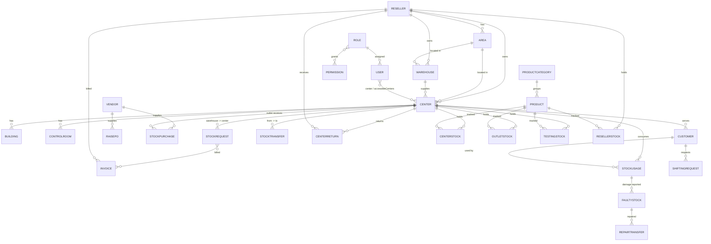

# Trunet Architecture

Backend API for the Trunet inventory and stock management system.

## Tech Stack

| Area          | Technology                                                    |
| ------------- | ------------------------------------------------------------- |
| Runtime       | Node.js (ES modules)                                          |
| Framework     | Express 4                                                     |
| Database      | MongoDB via Mongoose 8                                        |
| Auth          | JWT access + refresh tokens, bcryptjs                         |
| Validation    | express-validator                                             |
| Security      | helmet, cors, express-rate-limit                              |
| File handling | multer (uploads), exceljs / xlsx / csv-parser (import/export) |

## Repository Layout

```
Trunet/
├── backend/
│   ├── server.js          # Entry point: connect DB, then start HTTP server
│   ├── app.js             # Express app: global middleware + route mounting
│   ├── config/            # env.js, db.js, multer.js
│   ├── constants/         # Shared constants (status.js)
│   ├── routes/            # URL -> middleware chain -> controller
│   ├── controllers/       # HTTP layer (req/res)
│   ├── services/          # Business logic + DB operations
│   ├── models/            # Mongoose schemas
│   ├── validators/        # express-validator rules per module
│   ├── middlewares/       # auth, authorization, validation, upload, errors
│   ├── utils/             # ApiError, asyncHandler, token, password, helpers
│   ├── seeds/             # seedAuth.js (admin + roles/permissions)
│   └── docs/              # api.md, architecture.md
└── frontend/              # Placeholder (not started)
```

## Layered Architecture

```
Client
  │
  ▼
app.js ── helmet → cors → json → rate limiter (/api)
  │
  ▼
Route ── authMiddleware → authorizeAccess → attachAuthorizationContext → validator
  │
  ▼
Controller ── reads req, calls service, formats response
  │
  ▼
Service ── business rules, stock movement, DB queries
  │
  ▼
Model (Mongoose) ── MongoDB
  │
  ▼
errorMiddleware ── central error -> JSON response
```

| Layer      | Responsibility                                                |
| ---------- | ------------------------------------------------------------- |
| Route      | Declares endpoints and the middleware chain for each          |
| Validator  | Validates body, params, query before the controller runs      |
| Controller | HTTP only: extracts input, calls service, sends response      |
| Service    | Business logic; no Express objects, no permission definitions |
| Model      | Schema, references, indexes                                   |

> **Note:** Newer modules (Stock Transfer, Invoice, Center, Vendor, etc.) follow Controller → Service → Model. Several older modules (reports, center returns, center stock import, damage returns, shifting requests, usage summary, reseller stock) still query models directly from the controller and have no service yet.

## Startup Flow

1. `server.js` calls `connectDatabase()` (MongoDB via `MONGO_URI`).
2. Only after the DB connects does it call `app.listen(PORT)`.
3. If the DB fails, the process exits.

## Authentication & Authorization

**Authentication** (`authMiddleware`)

- Reads `Authorization: Bearer <token>` and verifies the JWT.
- Loads the user and role from MongoDB on every request, so role/status changes apply immediately.
- Rejects disabled users.
- Login is two-step: a token with `step: center_selection` is issued first and cannot access protected routes until a center is selected.
- Refresh tokens are stored in the `RefreshToken` collection. Logins are tracked in `LoginHistory`.

**Authorization** (`authorizeAccess` + `attachAuthorizationContext`)

- Permissions are database-driven: `Role` → `Permission` (module + action).
- Each route declares a module and accepted actions, for example `Transfer` with `*_own_center` or `*_all_center`.
- `attachAuthorizationContext` tells the service whether the user is limited to their own center or can see all centers.
- Super Admin bypasses permission checks (user flag, role flag, or `superadmin` role title).

## Error Handling

- Services and controllers throw `ApiError(statusCode, message)`.
- `asyncHandler` forwards async errors to Express.
- `errorMiddleware` is registered last and returns `{ success: false, message }`, with the stack trace in development only. It also maps Multer errors to 400.
- Some modules (Stock Transfer) use their own service error class and map Mongoose `ValidationError`, `CastError`, and duplicate-key errors inside the controller.

Success responses use `{ success: true, message, data }`.

## API Surface

All routes are mounted under `/api/v1` in `app.js`.

| Domain           | Base paths                                                                                            |
| ---------------- | ----------------------------------------------------------------------------------------------------- |
| Auth & access    | `/auth`, `/role`                                                                                      |
| Master data      | `/products`, `/product-categories`, `/vendor`, `/resellers`, `/packageDuration`                       |
| Locations        | `/centers`, `/areas`, `/buildings`, `/controlRooms`, `/warehouses`, `/customers`                      |
| Stock flow       | `/stockpurchase`, `/stockrequest`, `/raisePO`, `/stocktransfer`, `/stockusage`, `/shiftingrequest`    |
| Centers          | `/center-stock`, `/center-returns`, `/damage-returns`                                                 |
| Faulty / testing | `/faulty-stock`, `/testing-material`                                                                  |
| Billing          | `/invoices`                                                                                           |
| Reports          | `/reports`, `/reportsubmission`, `/available-reports`, `/availableStock`, usage summary, get-all-data |
| System           | `/health`                                                                                             |

Full endpoint details: `docs/api.md`.

## Data Model

39 Mongoose models in `backend/models/`. All use `timestamps: true`. Relations are `ObjectId` refs (no embedded joins), except line items which are embedded arrays.

### ER Diagram



### ER Diagram



### 1. Access & Auth

| Model          | Key fields                                                                                                                                         | Relations / notes                                                                                             |
| -------------- | -------------------------------------------------------------------------------------------------------------------------------------------------- | ------------------------------------------------------------------------------------------------------------- |
| `User`         | fullName, username (unique), email, mobile, password (`select: false`), status (Enable/Disable), isSuperAdmin, lastLogin, loginAttempts, lockUntil | `role` → Role, `center` → Center, `accessibleCenters[]` → Center                                              |
| `Role`         | roleTitle (unique, lowercased), isSuperAdmin, `permissions[]` ({module, permissions[]})                                                            | `createdBy` → User. Also supports legacy embedded permissions; `authorizationMiddleware` accepts both formats |
| `Permission`   | module, action, description, status                                                                                                                | Unique on (module, action)                                                                                    |
| `RefreshToken` | tokenHash (unique), expiresAt, revokedAt                                                                                                           | `user` → User                                                                                                 |
| `LoginHistory` | name, email, browser, ip, date                                                                                                                     | `user` → User                                                                                                 |

### 2. Organization & Locations

| Model         | Key fields                                                                                        | Relations / notes                                                                        |
| ------------- | ------------------------------------------------------------------------------------------------- | ---------------------------------------------------------------------------------------- |
| `Reseller`    | businessName, name, contactNumber, mobile, email, gstNumber, panNumber, address, logo             | Top of the hierarchy                                                                     |
| `Area`        | areaName                                                                                          | `reseller` → Reseller                                                                    |
| `Warehouse`   | warehouseName, warehouseCode (unique), status, stockVerified, address                             | `reseller` → Reseller, `area` → Area                                                     |
| `Center`      | centerName, centerCode (unique), **centerType (Center / Outlet)**, status, stockVerified, address | `reseller`, `area` (required when type is Center), `warehouse` (required)                |
| `Building`    | buildingName, displayName, address, landmark, pincode                                             | `center` → Center                                                                        |
| `ControlRoom` | same shape as Building                                                                            | `center` → Center                                                                        |
| `Customer`    | username (unique), name, mobile, email, address, `shiftingHistory[]`                              | `center` → Center; history entries hold fromCenter, toCenter, shiftingRequest, shiftedBy |

### 3. Product Catalog

| Model             | Key fields                                                                                                                                             | Relations / notes                             |
| ----------------- | ------------------------------------------------------------------------------------------------------------------------------------------------------ | --------------------------------------------- |
| `ProductCategory` | productCategory (unique), remark                                                                                                                       |                                               |
| `Product`         | productTitle (unique), productCode (unique), productPrice, salePrice, hsnCode, status, **trackSerialNumber**, **repairable**, **replaceable** (Yes/No) | `productCategory` → ProductCategory           |
| `Vendor`          | businessName, name, contactNumber, email (unique), gstNumber, panNumber, address, logo                                                                 |                                               |
| `PackageDuration` | packageDuration                                                                                                                                        | Lookup list                                   |
| `RepairCost`      | repairCost                                                                                                                                             | `product` → Product (unique)                  |
| `Counter`         | name, financialYear, sequence                                                                                                                          | Generates document numbers per financial year |

### 4. Stock Ledgers (current quantities)

Each ledger is one document per (owner, product), with a unique compound index. Serialized products keep `serialNumbers[]` (indexed).

| Model           | Owner key                       | Quantity fields                                                                                                        |
| --------------- | ------------------------------- | ---------------------------------------------------------------------------------------------------------------------- |
| `CenterStock`   | center + product                | total, available, inTransit, consumed                                                                                  |
| `OutletStock`   | outlet + product                | total, available, pendingTesting, inTransit, pendingRepaired, repaired, pendingTransferToReseller, transferredRepaired |
| `ResellerStock` | reseller + product              | total, available, consumed, damaged, repair, pendingReturn; `sourceBreakdown` (damageRepair / centerReturn)            |
| `TestingStock`  | center + product                | total, available, underTesting, tested, passed, failed                                                                 |
| `EntityStock`   | entityType + entityId + product | total, available. Polymorphic: customer, building, controlRoom, damage, stolen, damage return, other                   |
| `FilledStock`   | customer + product (+ center)   | quantity, status (active / transferred / returned); links to originating usage and shifting request                    |

### 5. Procurement & Distribution

| Model             | Key fields                                                                                                                                                                                    | Status values                                                                                          | Relations                                      |
| ----------------- | --------------------------------------------------------------------------------------------------------------------------------------------------------------------------------------------- | ------------------------------------------------------------------------------------------------------ | ---------------------------------------------- |
| `RaisePO`         | voucherNo (unique), date, `products[]`                                                                                                                                                        | pending, approved, rejected, cancelled                                                                 | vendor, outlet (Center), approvedBy, createdBy |
| `StockPurchase`   | invoiceNo (unique), type (new / refurbish), cgst / sgst / igst, transportAmount, totalAmount, `products[]` with per-serial status and location                                                | active, cancelled, partially_transferred, fully_transferred                                            | vendor, outlet (Center)                        |
| `StockRequest`    | orderNumber, challanNo (unique), `products[]`, warehouse / center challan approvals, shipping / receiving / completion / rejection info, `invoiceInfo`                                        | Draft, Submitted, Confirmed, Shipped, Incompleted, Completed, Rejected                                 | `warehouse` and `center` both → **Center**     |
| `StockTransfer`   | transferNumber (unique), `products[]` (qty, approved / received qty and serials), adminApproval, centerApproval, shippingInfo, receivingInfo, stockStatus (sourceDeducted / destinationAdded) | Draft, Submitted, Admin_Approved, Admin_Rejected, Confirmed, Shipped, Incompleted, Completed, Rejected | fromCenter, toCenter → Center                  |
| `Invoice`         | invoiceNumber (unique), `products[]`, hsnSummary, totals (outlet, damage repair, center return), cgst / sgst, metadata, invoiceHtml / invoicePdfPath, cancellationDetails                     | generated, sent, paid, cancelled                                                                       | `stockRequestIds[]`, reseller, `centers[]`     |
| `CenterReturn`    | returnNumber (unique), `products[]`, returnDate                                                                                                                                               | pending, accepted                                                                                      | center, reseller, requestedBy, acceptedBy      |
| `TestingMaterial` | requestNumber (unique), `products[]`, `testResults[]`                                                                                                                                         | pending_testing, under_testing, completed, cancelled                                                   | fromCenter, toCenter                           |

### 6. Usage, Returns & Repair

| Model               | Key fields                                                                                                                                                                                                                                              | Status values                                                                                                                                                    | Relations                                                              |
| ------------------- | ------------------------------------------------------------------------------------------------------------------------------------------------------------------------------------------------------------------------------------------------------- | ---------------------------------------------------------------------------------------------------------------------------------------------------------------- | ---------------------------------------------------------------------- |
| `StockUsage`        | usageType (Customer, Building, Building to Building, Control Room, Damage, Stolen from Center / Field, Damage Return, Other), connectionType (NC, Convert, Shifting, Repair), package and installation charges, `items[]`, change / revert audit fields | pending, completed, cancelled                                                                                                                                    | center, toCenter, customer, fromBuilding, toBuilding, fromControlRoom  |
| `ReturnRecord`      | usageType, `items[]`, remark                                                                                                                                                                                                                            | completed                                                                                                                                                        | originalUsageId → StockUsage, center, customer, buildings, controlRoom |
| `ReplacementRecord` | old / new serial number, replaceFor, qty, damageQty, connectionType, charges                                                                                                                                                                            |                                                                                                                                                                  | originalUsageId, product, center, replacedBy                           |
| `DamageReturn`      | serialNumber, quantity, old / new / total stock, connectionType, approval / rejection info                                                                                                                                                              | pending, approved, rejected, replaced, damage_pending                                                                                                            | originalUsageId, center, customer, product                             |
| `FaultyStock`       | batchNumber, quantity, pendingDamage / repaired / irrepaired / underRepair / transferred / damage quantities, `repairHistory[]`, `serialNumbers[]`                                                                                                      | pending_damage, damaged, under_repair, repaired, irreparable, disposed, returned_to_vendor, partially_repaired, transferred, pending_under_repair                | usageReference, center, toCenter, reseller, product                    |
| `RepairTransfer`    | quantities by repair state, `repairUpdates[]`, totalRepairCost, completion dates                                                                                                                                                                        | pending_under_repair, under_repair, repaired, irreparable, returned, partially_accepted, pending_transfer, transferred, completed, cancelled, partially_repaired | faultyStock, fromCenter, toCenter, product                             |
| `ShiftingRequest`   | customer address change, remark, customerCenterUpdated                                                                                                                                                                                                  | Pending, Approve, Reject                                                                                                                                         | customer, fromCenter, toCenter                                         |
| `StockClosing`      | date, reportMonth / reportYear, `products[]`, totalProductQty, totalDamageQty, stockClosingForOtherCenter                                                                                                                                               | Draft, Submitted, Approved, Duplicate                                                                                                                            | center, closingCenter, linkedStockClosing                              |

### Design Notes

- **Line items are embedded.** Documents such as `StockTransfer.products[]` and `StockPurchase.products[]` carry quantities, serials, and per-line remarks inside the parent document.
- **Serial tracking.** Products with `trackSerialNumber = Yes` move through the system by serial number. Ledgers index `serialNumbers.serialNumber` for lookup.
- **Approval trail.** Workflow models store `approvedBy` / `rejectedBy` / `createdBy` / `updatedBy` references to User, with timestamps.
- **Document numbering.** Human-readable numbers (`transferNumber`, `orderNumber`, `invoiceNumber`, `returnNumber`, `requestNumber`) are unique indexed strings. `Counter` supports per-financial-year sequences.
- **Naming quirk.** `StockRequest.warehouse` references the `Center` model, not `Warehouse`.

## Configuration

Loaded in `config/env.js` from `.env`:

`NODE_ENV`, `PORT` (default 5000), `MONGO_URI`, `JWT_SECRET`, `JWT_EXPIRES_IN` (15m), `REFRESH_TOKEN_SECRET`, `REFRESH_TOKEN_EXPIRES_IN` (7d), `ADMIN_NAME`, `ADMIN_USERNAME`, `ADMIN_EMAIL`, `ADMIN_PASSWORD`.

Seed the initial admin and auth data with `npm run seed:auth`.

## File Uploads

- `multer` stores images on local disk under `uploads/products` and `uploads/vendors` (created at startup, git-ignored).
- Bulk imports use `exceljs`, `xlsx`, and `csv-parser`.

## Security

- `helmet` for HTTP headers.
- Rate limit of 6000 requests per 15 minutes on `/api`.
- Passwords hashed with bcryptjs.
- Secrets live in `.env`, which is git-ignored (only `.env.example` is committed).

## Branching

Feature-branch workflow (`feature/<module>`) merged into `main`.

## Known Gaps

- `frontend/` is empty.
- No automated tests (`npm test` is a placeholder).
- Module layering is inconsistent (see note above).
- CORS is open to all origins.
- Two route files are mounted for available reports, and `usageSummaryRoutes` / `getAllDataRoutes` are mounted directly at `/api/v1`.
